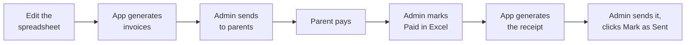
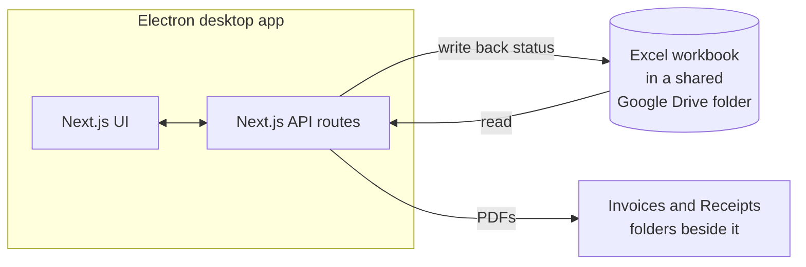

# AccelLearn Invoices

**A desktop app that turns a tuition centre's Excel roster into invoice and receipt PDFs, while the spreadsheet stays in charge.**

Built for **AccelLearn**, a tuition centre in Singapore, as a paid client project (July–August 2026). It bills 80–100 students a term and replaced invoices and receipts that were typed up by hand, one family at a time.

The owner already ran the business from one Excel file. So the app doesn't ask anyone to learn a new system. It reads that spreadsheet, produces branded PDFs in one click, and writes its progress back into the same spreadsheet.

---

## The billing cycle



Every step the app takes is recorded in the spreadsheet, so anyone who opens the file can see where each family is up to.

---

## Features

**Invoices**
- Loads the live spreadsheet and works out every bill: `rate × hours × lessons + material fee`, per subject.
- One PDF per child. A child taking two subjects gets one invoice with a line for each.
- **Review before anything is final:** preview each PDF, then approve or flag it with a note.
- Exports approved invoices to a shared folder and stamps each child's row in Excel (`INV-AY26T4-S007 · 01/08/26`).
- One-off overrides (a different rate or lesson count this term) without touching the spreadsheet.
- Students with 0 lessons this term are set aside under "Not billed this term" instead of getting a $0 invoice.

**Receipts**
- A child is ready for a receipt as soon as their **Paid** cell in Excel is filled in.
- Receipt numbers are fixed per child and term (`R-AY26T4-S007`). Generating a receipt again overwrites the same file, so two conflicting receipts can't exist.
- The Excel cell turns **red** when a receipt is issued and **green** once it's marked as sent.

**The spreadsheet stays in charge**
- **Two-way sync:** clear a status cell in Excel, hit Refresh, and the app follows. People trust it because Excel always has the final say.
- One **Master** tab where each student is typed once. Each term gets its own tab, which pulls names from Master by formula.
- A **Status** page that counts who has been invoiced, who has paid and who has a receipt.
- **Settings** for everything printed on the invoice: company name, PayNow UEN, term dates, fee and make-up policies. No code changes needed.

**Safeguards against everyday spreadsheet mistakes**
- Every child gets a permanent **Student ID** that never changes and is never reused. Invoices and receipts are tied to it, so adding, deleting or reordering students can't move anyone's records.
- On every refresh the app checks for duplicate IDs, accidental sorting, status marks next to the wrong child, a term tab copied without being cleared, and rows left behind by deletions. Each problem appears in a yellow panel naming the exact row.
- Finished terms can be **frozen**, so a later rate change can't rewrite fees parents were already billed.

**A real desktop app**
- Windows installer and Mac `.dmg`, built automatically by GitHub Actions for every release.
- Runs entirely on the user's computer. No server, no database, no accounts.

---

## How it works



- **Electron** starts a local Next.js server on a random free port and opens it in a window.
- **Next.js 16** (App Router, React 19, Tailwind 4) serves both the screens and the API routes.
- **SheetJS** (`xlsx`) reads the workbook. **ExcelJS** writes back, and only to the cells the app owns: invoice issued, receipt issued, receipt sent and Student ID.
- **@react-pdf/renderer** draws the invoice and receipt PDFs.
- **Google Drive for desktop** shares the folder between admins. The app treats it as an ordinary folder on disk, which is why there's no backend.

### Why it's built this way

| Decision | Reason |
|---|---|
| Excel is the single source of truth | The owner already knew and trusted it. Two-way sync kept him in control, which mattered more to adoption than a nicer database. |
| A person approves every invoice | Billing mistakes reach parents. Nothing is final until someone has previewed it. |
| Everything stays on the user's computer | The data covers minors and their parents, and Singapore's data-protection law (PDPA) applies. Nothing goes to a third-party service. |
| Permanent Student IDs | An early version matched invoices to children by row number. Deleting one student shifted everyone below and re-issued their invoices. Fixed for good by giving each child an ID that never changes. |
| Fixed document numbers | Generating the same invoice or receipt again always gives the same number and file, so retrying is always safe. |
| Admins send the PDFs themselves | Automatic WhatsApp sending was prototyped and then cut with the owner's agreement. |

---

## Getting started

### Requirements
- [Node.js](https://nodejs.org) 22 (what CI uses) and npm
- An Excel workbook in the expected layout (see below). No sample is committed, because the real one holds children's personal data.

### Run it in a browser (quickest)

```bash
git clone https://github.com/elliotnah05/accellearn_invoice.git
cd accellearn_invoice
npm install
npm run dev
```

Open <http://localhost:3000>, go to **Settings → Folders**, and set:
- **Spreadsheet path:** the full path to your `.xlsx` file
- **Output folder:** where the `Invoices/` and `Receipts/` folders should go

When the home page shows a green **"Connected — N students"** banner, you're ready. (A few desktop-only buttons, like *Open folder*, only work in the Electron app.)

### Run it as the desktop app

```bash
npm run build      # builds the Next.js standalone server
npm run electron   # opens it in an Electron window
```

### Build the installers

```bash
npm run build && npm run dist   # output goes to dist/
```

To publish a release, push a version tag. GitHub Actions builds the Windows `.exe` and the universal Mac `.dmg` and attaches both to a GitHub Release:

```bash
git tag v0.15.0 && git push origin v0.15.0   # keep package.json "version" in step
```

The builds are unsigned. Windows shows a "protected your PC" warning (More info → Run anyway). On a Mac the first launch needs System Settings → Privacy & Security → Open Anyway.

---

## The spreadsheet layout

One workbook with a `Master` tab first, then one tab per term (named like `AY 26 T4`).

**Master tab:** each student is typed in once, one row per subject.

| A | B | C | D | E | F | G | H | I |
|---|---|---|---|---|---|---|---|---|
| Serial No | Student Name | Parent Name | School | Level | Subject | Duration (hrs) | Rate/hr ($) | Student ID *(app writes)* |

**Term tabs:** columns A–H pull from Master by formula, and the term's billing goes in I–R.

| I | J | K | L | M | N | O | P | Q | R | S |
|---|---|---|---|---|---|---|---|---|---|---|
| Lessons | Material Fee | Fee Notes | Invoice Issued *(app)* | Paid | Date of Receipt | Receipt Issued *(app)* | Different End Date | Backed Up | Receipt Sent *(app)* | Student ID *(formula)* |

A few rules the app relies on:
- A blank **Lessons** cell means the standard 12. `0` means not billed this term.
- A child with two subjects has two rows, with the name left blank on the second.
- **Paid** counts as paid when it holds anything except blank, `no`, `n`, `false` or `0`.

The full column-by-column reference, everyday tasks and troubleshooting table are in **[ADMIN_GUIDE.md](ADMIN_GUIDE.md)**, the manual handed to the centre's admins.

---

## Tests

The riskiest part of the app is keeping term tabs correct when someone adds or deletes a student on Master. A regression suite covers it:

```bash
npm run test:roster -- --workbook "path/to/your workbook.xlsx"
```

It runs every scenario against a throwaway copy, never your file. It also reproduces what Excel itself does when rows move (shifting references, `#REF!` errors, recalculation), so the app is tested against a realistic workbook. Details: [scripts/roster-tests/README.md](scripts/roster-tests/README.md).

---

## Project structure

```
app/                  Next.js App Router
  page.tsx            Home: Invoices | Receipts, connection banner
  import/ invoices/   Load the sheet → review, approve, export invoices
  receipts/ status/   Receipts flow and the read-only status overview
  settings/           Folders + everything printed on the invoice
  api/                students, upload, generate, export, receipts, config
  send/, api/send/    WhatsApp sending prototype (cut; not linked in the UI)
lib/
  parse-students.ts   Workbook → students, bills, and the safeguard checks
  sheet-writeback.ts  Writes status stamps + Student IDs back into Excel
  invoice-pdf.tsx     Invoice PDF layout
  receipt-pdf.tsx     Receipt PDF layout
  receipt-status.ts   Reads receipt state from the sheet (two-way sync)
  billing-store.ts    Receipt numbering + the local receipt log
electron/             Desktop shell: starts the local server, opens the window
scripts/
  add-term.js         Creates a correctly linked, blank term tab
  freeze-term.js      Freezes a finished term
  add-student-ids.js  One-time upgrade that assigns Student IDs
  roster-tests/       Regression suite for adding/removing students
.github/workflows/    Release build for Windows + Mac
```

---

## Data protection

- **No student data is in this repository**, and none is ever written to it. The tests read a workbook you point them at and work on a temporary copy.
- The app only talks to files on the user's own computer. The only thing it creates outside the spreadsheet is the PDFs in the output folder.
- The receipt log the app keeps on each computer stores ID numbers only, never names.

---

## Known limitations

- **One writer at a time.** Two admins can read at once, but if two people save the spreadsheet at the same moment, the later save wins.
- **No automatic sending.** Admins send each PDF themselves.
- **Unsigned builds**, so first launch shows an operating-system warning.
- **Columns are found by position.** Inserting or reordering columns in the spreadsheet breaks the app (the admin guide says so in bold).

---

Built by [Elliot Nah](https://github.com/elliotnah05).
